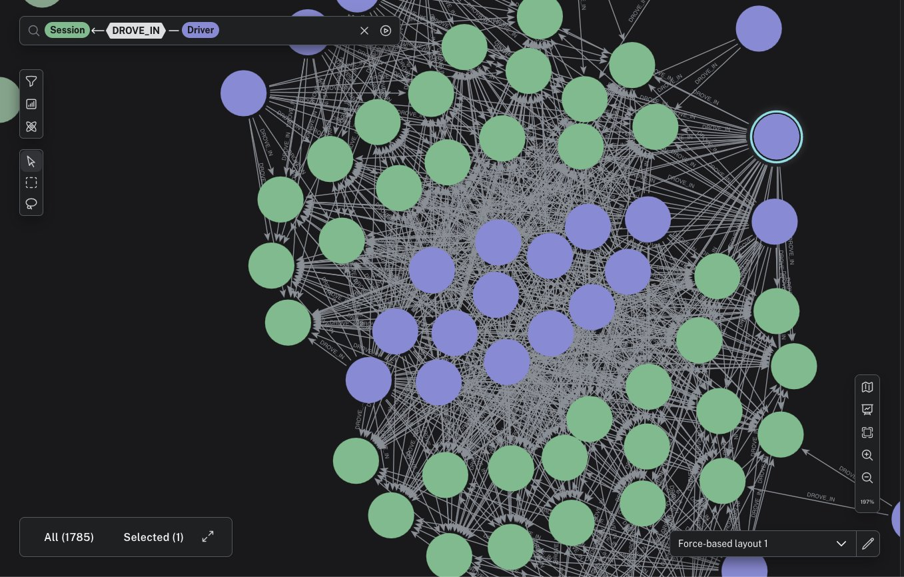
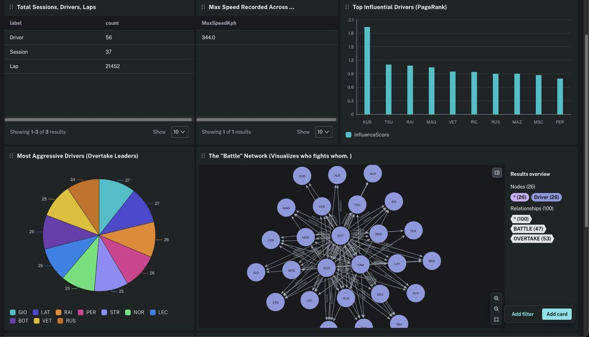
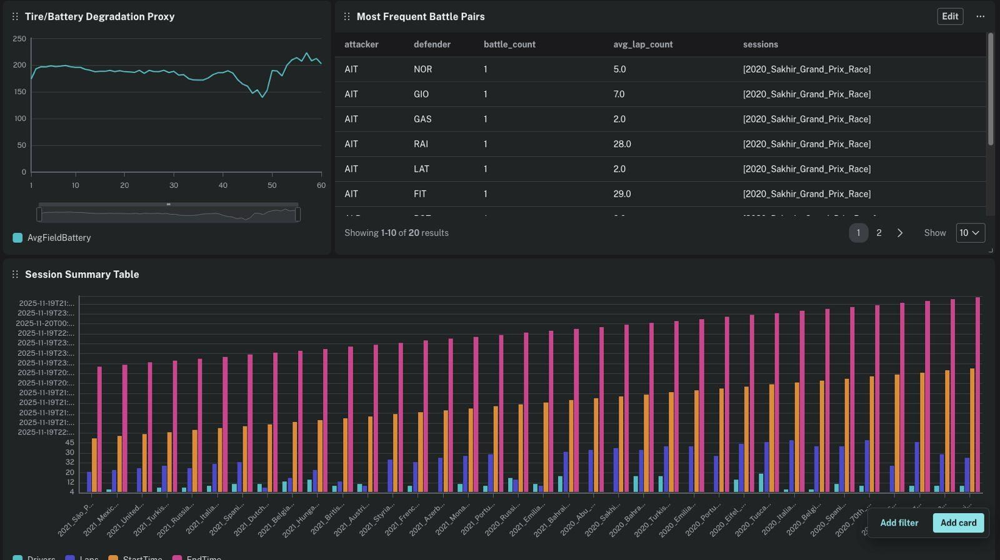
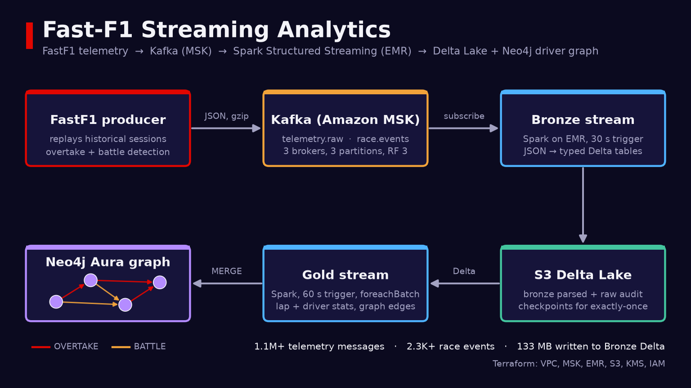
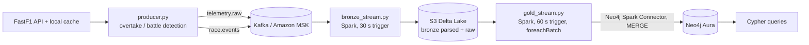

# Fast-F1 Streaming Analytics

Replay Formula 1 telemetry from the FastF1 library through Kafka and Spark Structured Streaming, land it in a Delta Lake, and build a live driver-interaction graph (overtakes, battles, laps) in Neo4j.




## What it does

- A Python producer loads F1 sessions with [FastF1](https://github.com/theOehrly/Fast-F1), turns car telemetry (speed, throttle, brake, gear, RPM, DRS, X/Y/Z track position, tyre compound and age, weather) into JSON events, and replays them to Kafka at a configurable speed-up.
- The producer also derives race events from lap positions: `LAP_COMPLETION`, `PIT_STOP`, `OVERTAKE` (position gained lap over lap) and `BATTLE` (two drivers within one position for 2+ consecutive laps).
- A **Bronze** Spark stream reads both Kafka topics, parses them against typed schemas, and writes parsed and raw (audit) Delta tables to S3 with exactly-once checkpoints.
- A **Gold** Spark stream reads Bronze as a stream, aggregates per-lap and per-driver stats, and MERGEs `Driver`, `Session`, `Lap` and `Team` nodes plus `DROVE_IN`, `COMPLETED_BY`, `OVERTAKE` and `BATTLE` relationships into Neo4j Aura.
- All AWS infrastructure (MSK, EMR, S3, KMS, IAM, security groups) is defined in Terraform.

## Results

### Graph analytics on Neo4j Aura

After streaming sessions from the 2020 to 2025 seasons through the pipeline, the team's Neo4j Aura dashboard showed:

| Metric | Value |
| --- | --- |
| Drivers / sessions / laps in the graph | 56 / 37 / 21,452 |
| Highest recorded speed | 344.0 km/h |
| Battle network | 100 relationships (47 `BATTLE`, 53 `OVERTAKE`) between 26 drivers |
| Overtake leaders | 24 to 27 overtakes each for the top ten drivers |



PageRank over the overtake and battle graph ranks driver influence (top right). The second dashboard page tracks a tyre and battery degradation proxy over 60 laps, the most frequent battle pairs, and drivers, laps and timing per session:



### Pipeline throughput (dev deployment)

Recorded in [`docs/architecture.md`](docs/architecture.md) during the AWS dev run:

| Stage | Result |
| --- | --- |
| Kafka `telemetry.raw` | 1,116,826 messages |
| Kafka `race.events` | 2,343 messages (laps, pit stops, overtakes, battles) |
| Bronze Delta on S3 | 133.58 MB written (45.17 MB parsed telemetry, 88.02 MB raw) |
| Gold to Neo4j (test session) | 4 drivers, 1 session, 41 laps, 41 `COMPLETED_BY` and 3 `DROVE_IN` relationships |

## How it works





**Kafka topics** (`kafka/topics.yaml`): `telemetry.raw` keyed by `<driver>_<lap>`, `race.events` keyed by `event_id`. Both have 3 partitions, replication factor 3, `min.insync.replicas=2` and 7-day retention. The producer sends gzip-compressed JSON with `acks=all`.

**Bronze** (`spark/bronze_stream.py`): one streaming query per topic for parsed rows and one for raw rows, capped at 100K offsets per trigger, each with its own checkpoint. Every row keeps its Kafka key, partition, offset and timestamp plus an `ingested_at` column.

**Gold** (`spark/gold_stream.py`): reads the parsed Bronze tables with `maxFilesPerTrigger`, drops rows without a session or driver, and writes graph nodes and edges through `foreachBatch`. Optional streaming-algorithm features from `spark/streaming_algorithms.py`:

| Flag | Default | What it does |
| --- | --- | --- |
| `--enable-hyperloglog` | on | `approx_count_distinct` for driver and lap counts per session |
| `--enable-sampling` | on | Reservoir sample of cleaned telemetry per batch (`--sample-size`, default 1000) |
| `--enable-pagerank` | off | GraphFrames PageRank over the overtake/battle graph, written to `Driver.pagerankScore` |
| `--enable-communities` | off | MinHash LSH clustering of driver telemetry profiles, written as a community id |

**Graph model** (Neo4j):

```
(Driver)-[:DROVE_IN]->(Session)
(Lap)-[:COMPLETED_BY]->(Driver)
(Driver)-[:OVERTAKE {lapNumber, avgGapMs, deltaTimeMs}]->(Driver)
(Driver)-[:BATTLE {lapCount, avgGapMs}]->(Driver)
```

## Tech stack

| Layer | Tools |
| --- | --- |
| Source | FastF1 3.6, pandas |
| Messaging | Apache Kafka on Amazon MSK (Kafka 3.6), kafka-python; local Kafka + Kafdrop via Docker Compose |
| Processing | Spark 3.5 Structured Streaming on Amazon EMR 7.10, Delta Lake, GraphFrames, Spark MLlib (MinHash LSH) |
| Storage | Amazon S3 (raw, artifacts, checkpoints buckets), KMS encryption |
| Graph | Neo4j Aura, Neo4j Connector for Apache Spark |
| Infrastructure | Terraform (AWS provider >= 5.60), Bash setup and monitoring scripts |

## Quickstart

### Local: replay a race into Kafka

Requires Docker, Python 3.10 or 3.11 and [uv](https://docs.astral.sh/uv/).

```bash
cd kafka
docker compose up -d kafka kafdrop      # broker on localhost:9092, UI on http://localhost:9000
uv sync && source .venv/bin/activate

# Replay the 2024 Bahrain GP race at 50x into telemetry.raw and race.events
make produce-local
# or pick another session
make produce-local PRODUCER_SEASON=2023 PRODUCER_EVENT=Monaco PRODUCER_SESSION=R

# Inspect a topic
make consume-local CONSUMER_TOPIC=race.events
```

The first run downloads the session into `.fastf1-cache/`. Add `ARGS="--dry-run"` to parse a session without sending anything.

Then run the Bronze stream against the local broker (needs a local Spark 3.5):

```bash
cd spark
spark-submit \
  --packages io.delta:delta-spark_2.12:3.1.0,org.apache.spark:spark-sql-kafka-0-10_2.12:3.5.0 \
  bronze_stream.py \
  --bootstrap-servers localhost:9092 \
  --starting-offsets earliest \
  --output-base /tmp/f1/bronze \
  --checkpoint-base /tmp/f1/checkpoints/bronze
```

### AWS: MSK + EMR + Neo4j Aura

```bash
# 1. Infrastructure (edit infra/terraform.tfvars first: VPC, subnets, your IP)
cd infra
make preflight && make init && make plan && make apply

# 2. Neo4j Aura credentials: copy the example and fill it in (git-ignored)
cp ../neo4j/Neo4j.txt.example ../neo4j/Neo4j.txt
../neo4j/setup_neo4j_schema.sh            # constraints and indexes

# 3. Package Spark jobs, copy producer + env to the EMR master, create topics
cd .. && ./scripts/setup_all.sh
```

`setup_all.sh` prints the exact `spark-submit` commands for the cluster. The Gold job takes:

```bash
spark-submit --master yarn \
  --packages io.delta:delta-spark_2.12:3.1.0,org.neo4j:neo4j-connector-apache-spark_2.12:5.3.1_for_spark_3,graphframes:graphframes:0.8.3-spark3.5-s_2.12 \
  --conf spark.sql.extensions=io.delta.sql.DeltaSparkSessionExtension \
  --conf spark.sql.catalog.spark_catalog=org.apache.spark.sql.delta.catalog.DeltaCatalog \
  gold_stream.py \
  --bronze-base "$SPARK_BRONZE_BASE" \
  --checkpoint-base "$SPARK_CHECKPOINT_BASE/gold" \
  --neo4j-uri "$NEO4J_URI" --neo4j-username "$NEO4J_USERNAME" --neo4j-password "$NEO4J_PASSWORD" \
  --write-to-neo4j
```

Check pipeline health from the EMR master with `scripts/check_pipeline_status.sh [--detailed]`, and run sample Cypher with `neo4j/test_analytics_queries.sh`.

## Project layout

```
.
├── docs/                    architecture plan, ingestion design, streaming algorithms, draw.io diagram
├── infra/                   Terraform root + modules (msk, emr-cluster, s3, kms, kafka-ec2), preflight discovery
├── kafka/
│   ├── producer/producer.py FastF1 -> Kafka producer with overtake/battle detection
│   ├── scripts/create_topics.py   topic creation (plain or MSK IAM auth)
│   ├── topics.yaml          topic definitions
│   └── docker-compose.yml   local Kafka (KRaft) + Kafdrop
├── spark/
│   ├── bronze_stream.py     Kafka -> S3 Delta
│   ├── gold_stream.py       Delta -> Neo4j graph
│   ├── schemas.py           telemetry and race-event schemas
│   └── streaming_algorithms.py   HyperLogLog, reservoir sampling, PageRank, MinHash LSH
├── neo4j/                   schema setup, sample queries, cleanup
└── scripts/                 one-shot EMR setup, MSK env sync, pipeline status checks
```

## Team

Built as a graduate course project in the Department of Applied Data Science, San José State University.

| Member | Focus |
| --- | --- |
| Shravankumar Nagarajan | AWS platform and Terraform (MSK, EMR, S3, IAM) |
| Chaitanya Uppalapati | Data ingestion: FastF1 to Kafka producer |
| Shreyas Durairajalu | Spark Bronze and Gold streaming jobs |
| Kalyan Mamidi | Neo4j graph and observability |

Data comes from the [FastF1](https://github.com/theOehrly/Fast-F1) library. This project is not affiliated with Formula 1.
